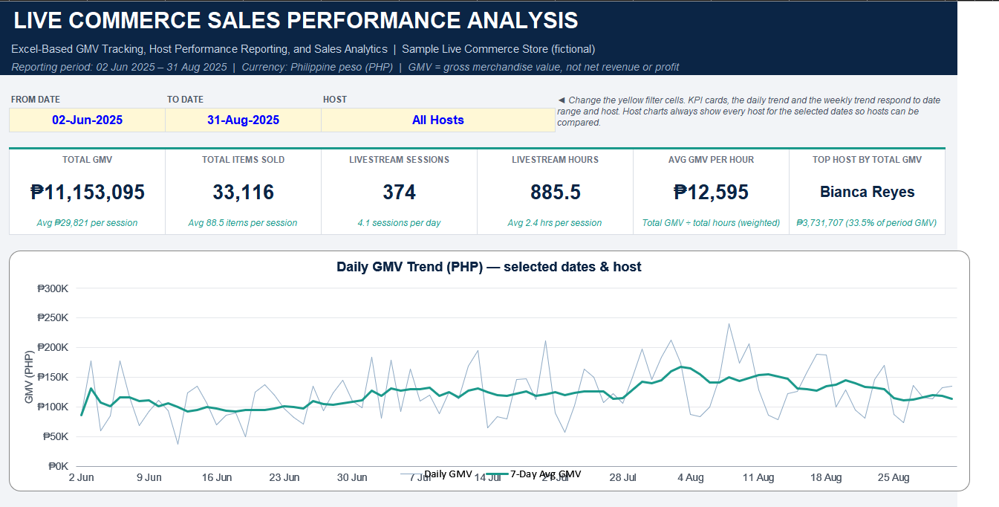
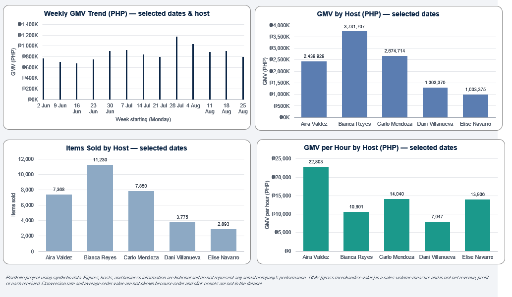
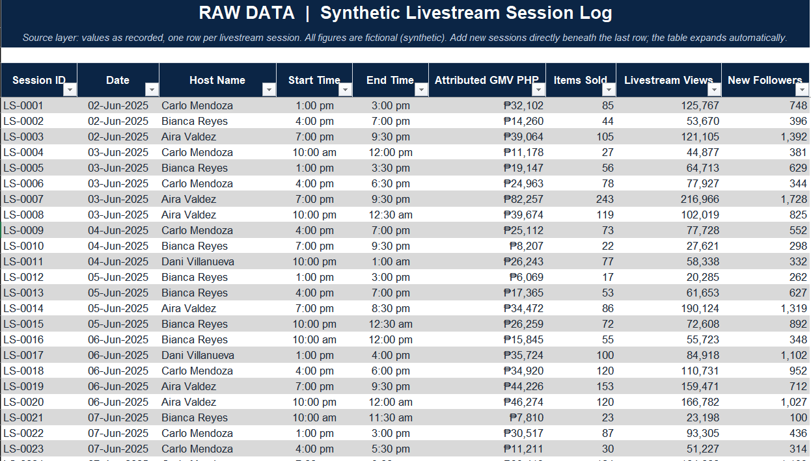
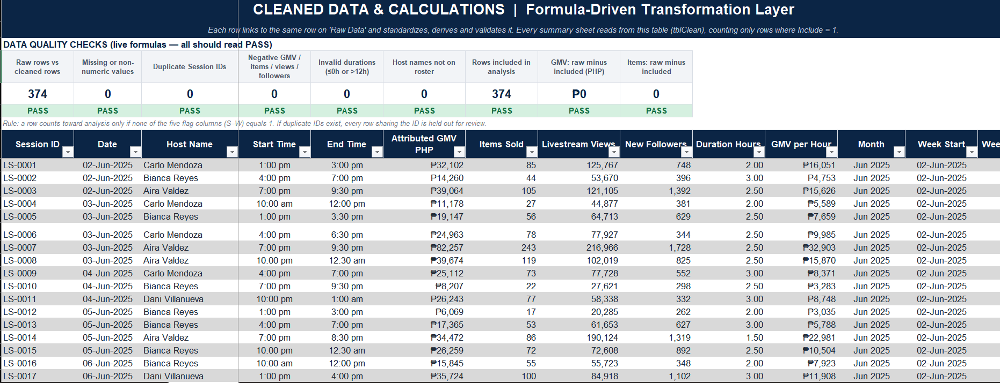
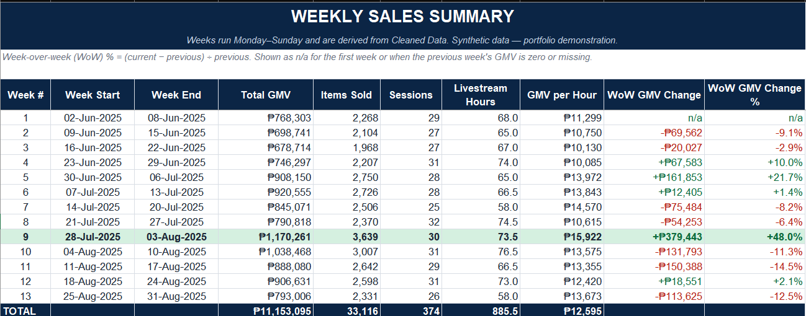
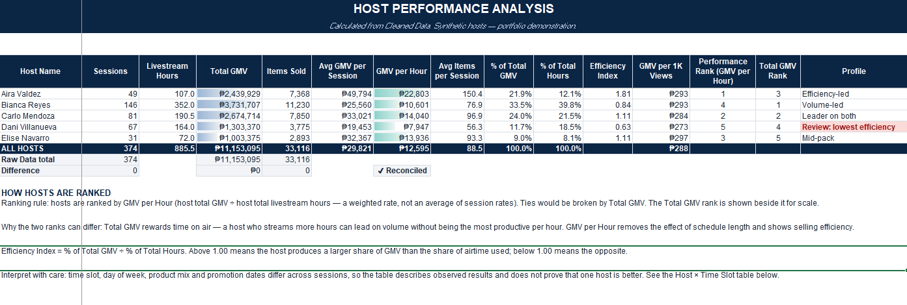
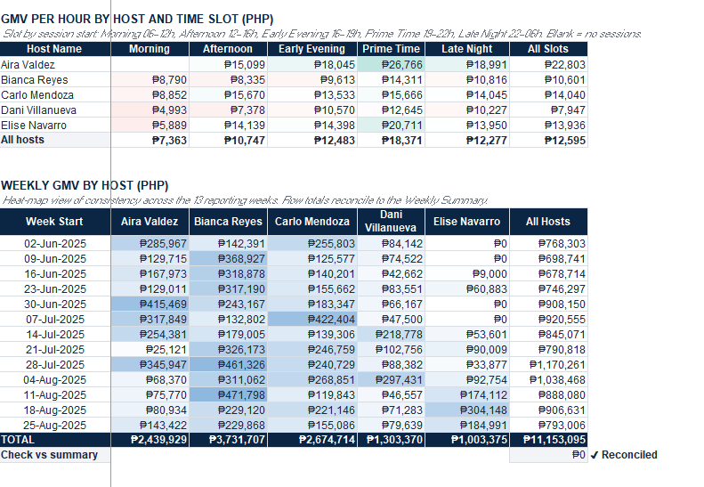
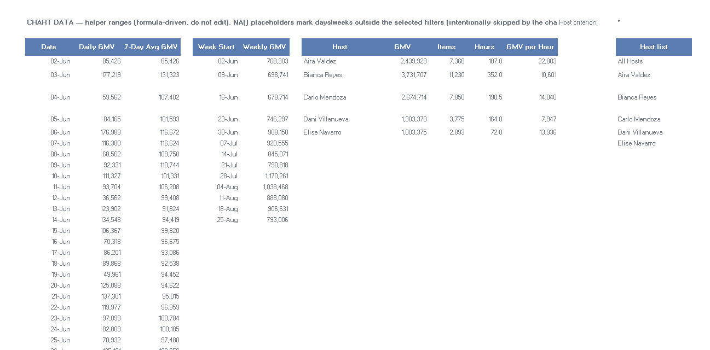
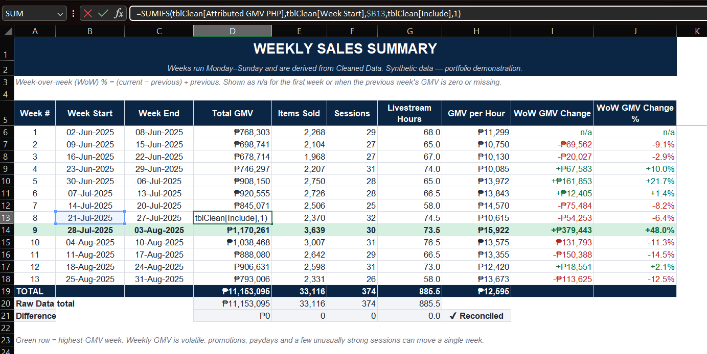

# Live Commerce Sales Performance Analysis
**Excel-Based GMV Tracking, Host Performance Reporting, and Sales Analytics**

> Portfolio project using synthetic data. Figures, hosts, and business information are fictional and do not represent any actual company's performance.

A self-directed Excel project inspired by my experience recording livestream sales and GMV in spreadsheets. It rebuilds that workflow as a clean, auditable analytics workbook for a fictional store, "Sample Live Commerce Store".

**Download the workbook:** [Live_Commerce_Sales_Performance_Analysis.xlsx](Live_Commerce_Sales_Performance_Analysis.xlsx)

## Dashboard preview

The dashboard has date-range and host filters (yellow cells). KPI cards and the daily and weekly trends update with the filters.

## What it shows
- Raw → cleaned → summarised → dashboard → insights workflow
- 374 synthetic livestream sessions, 5 fictional hosts, 13 full weeks (02 Jun – 31 Aug 2025)
- Excel Tables and structured references, SUMIFS/COUNTIFS, RANK, CORREL, SLOPE, named ranges, data validation, conditional formatting
- Live data-quality checks and reconciliation of every report back to the raw data
- Formula-driven dashboard filters (date range + host), six KPI cards, five charts
- Eight calculated business insights with caveats and next steps

## Workbook map
| Sheet | Purpose |
|---|---|
| README | Purpose, definitions, data dictionary, navigation |
| Raw Data | Source table `tblRaw` (inputs only) |
| Cleaned Data | Formula table `tblClean`: standardising, derived fields, validation flags, quality checks |
| Daily Sales | Daily GMV, items, sessions, hours, GMV/hour, 7-day average |
| Weekly Summary | Weekly totals, week-over-week change, chart |
| Host Performance | Host scorecard, documented ranking rule, host × time-slot table |
| Dashboard | Executive view with filters |
| Insights | Findings, why it matters, next steps |

## Data pipeline

Raw records feed a formula-driven cleaning layer with live quality checks (all PASS on the sample data):

## Reports
**Weekly summary** with week-over-week change (first week and zero-denominator cases show n/a):

**Host performance**, ranked by GMV per hour, with total-GMV rank alongside:

**Host × time-slot efficiency** heat-map:

## Insights

## Example formula
Structured-reference SUMIFS used throughout the summaries:

## Analytical decisions
- **GMV per hour is weighted**: total GMV ÷ total hours, never an average of session rates.
- **Hosts are ranked by GMV per hour**, with total-GMV rank shown alongside, because total GMV rewards airtime.
- **Not calculated**: conversion rate and average order value (no order or click counts in the data).
- **GMV is not revenue or profit.**

## Limitations
Synthetic data; no product, cost, or order fields; the dashboard uses formula-driven filters instead of PivotTable slicers; findings describe associations, not causes.

## Author
John Paulo Lumagbas, BS Computer Engineering, Polytechnic University of the Philippines.
